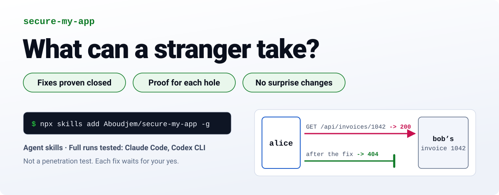

<p align="center">
  <picture>
    <source media="(prefers-color-scheme: dark)" srcset="assets/hero-dark.svg">
    
  </picture>
</p>

<p align="center">
  <a href="https://github.com/Aboudjem/secure-my-app/actions/workflows/validate.yml"></a> <a href="LICENSE"></a> <a href="https://github.com/Aboudjem/secure-my-app/stargazers"></a>
</p>

<p align="center">
  <b>English</b> · <a href="READMEs/zh-CN.md">简体中文</a> · <a href="READMEs/ja.md">日本語</a> · <a href="READMEs/es.md">Español</a> · <a href="READMEs/fr.md">Français</a>
</p>

<p align="center">
  <strong>Find what a stranger can take from your app. Then close it and prove it closed.</strong>
</p>

## What it does

- Reads your whole app, not a diff, and runs 65 named security checks against it.
- Reports a hole only with the command that proves it and the output that command gave.
- Closes them one at a time, only after you approve that fix, then re-proves each one shut.

## Install

```bash
claude plugin marketplace add Aboudjem/10x
claude plugin install secure-my-app@10x       # Claude Code
npx skills add Aboudjem/secure-my-app         # Cursor, Codex, Copilot, Gemini CLI, 70+ others
```

## What you get

`.secure-my-app/report.md` opens on a gate line, then every finding carries the same seven fields.

```text
SECURE-MY-APP   gate: DO NOT LAUNCH
coverage 47 checked / 8 unproven / 4 n/a   [static + live: tidemark-preview.vercel.app]
findings: 2 critical  1 high  1 medium  0 low
CRITICAL  R1  Anyone can read every row of bookings
WHAT     Row level security is off on public.bookings, so the publishable key reads it all.
WHERE    supabase/migrations/0002_bookings.sql:11
PROOF    [executed] curl -s "$URL/rest/v1/bookings?select=*" -H "apikey: sb_publishable_7f2a..."
                    -> 200, 1204 rows: id, user_id, email, phone, address_line1, total_cents
IMPACT   Every customer's email, phone, address and what they paid, to anyone with devtools.
FIX      alter table public.bookings enable row level security;
         create policy "own" on public.bookings for select to authenticated
           using ((select auth.uid()) = user_id);
VERIFY   anon curl returns []; user A reads their own row; user B gets empty, not an error.
STATUS   OPEN
```

`PROOF` is a real command and its real output, redacted. `VERIFY` is the command whose output has to
change before anything is called fixed. `.secure-my-app/surface.json` is what makes run two a diff.

## What it checks

65 controls in seven groups, in the order an attacker tries them ([full catalogue](docs/controls.md)).

| Group | Covers |
| --- | --- |
| KEYS (8) | Secrets in the repo, key exposure, key scope, rotation |
| DOOR (9) | Login, sessions, cookies, password storage, tokens |
| ROOMS (10) | Row level security, IDOR, tenant isolation, mass assignment |
| PIPES (13) | Injection, XSS, CSRF, SSRF, CORS, redirects, webhooks, headers |
| VAULT (8) | Encryption at rest, response shape, error leakage, logs, backups |
| FLOOR (10) | Rate limits, bots, uploads, price tampering, AI features |
| SUPPLY (7) | Dependencies, lockfiles, install scripts, CI permissions |

## How it works

- Nothing is reported without proof. What it cannot settle comes back `UNPROVEN`, never as a pass.
- Nothing in your repo changes until you approve that one fix. There is no batch mode.
- Every fix is proven twice: the attacker's request now fails, and your own login still works. A patch
  that returns `403` to everybody closes the hole and closes the product.
- It never rewrites git history and never rotates a credential. It writes the runbook, you run it.

## Good to know

- A clean run is not proof your app is secure. The gate's third label reads `NOTHING CONFIRMED HERE`,
  never printed without its coverage counts: nothing rose to CRITICAL or HIGH in what the run checked.
- It is read-only until you approve a fix. With your explicit yes it makes at most about 30 benign
  requests against one host you confirmed you own. No `DELETE`, no load testing.
- It is not a penetration test and nobody signs it. The rest is in [Honest limits](docs/limits.md).

## Learn more

- [Quickstart](docs/quickstart.md), a first run start to finish
- [A worked report](examples/sample-report.md), four findings and the unproven appendix
- [Honest limits](docs/limits.md), everything secure-my-app does not promise
- [Install in your editor](docs/editors.md) · [FAQ](docs/faq.md) · [Contributing](CONTRIBUTING.md) · [The skill itself](skills/secure-my-app/SKILL.md)

---

<sub>Built by <a href="https://github.com/Aboudjem">Adam Boudjemaa</a> · MIT. Verified in CI by 162 checks, 90 from <code>tests/test_manifests.py</code> and 72 from <code>evals/check_skill.py</code>.
Control catalogue, severity matrix and RLS semantics re-derived from the PostgreSQL, Supabase and OWASP primary docs, 2026.
Sibling of <a href="https://github.com/Aboudjem/loopify">loopify</a> and <a href="https://github.com/Aboudjem/goalify">goalify</a>. <a href="https://github.com/Aboudjem/secure-my-app/issues">Spot a gap?</a></sub>
