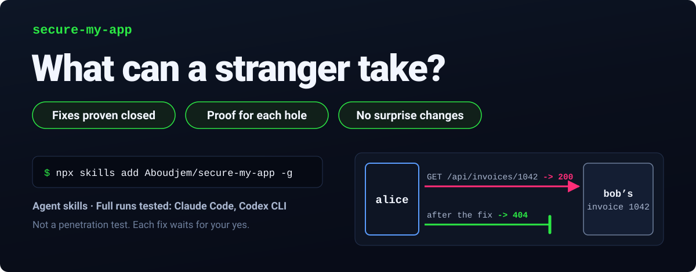

<p align="center">
  <picture>
    <source media="(prefers-color-scheme: dark)" srcset="assets/hero-dark.svg">
    <source media="(prefers-color-scheme: light)" srcset="assets/hero-light.svg">
    
  </picture>
</p>

<p align="center">
  <a href="https://github.com/Aboudjem/lockpatch/actions/workflows/validate.yml"></a>
  <a href="LICENSE"></a>
  <a href="https://github.com/Aboudjem/lockpatch/stargazers"></a>
</p>

<p align="center">
  <b>English</b> · <a href="READMEs/zh-CN.md">简体中文</a> · <a href="READMEs/ja.md">日本語</a> · <a href="READMEs/es.md">Español</a> · <a href="READMEs/fr.md">Français</a>
</p>

<p align="center">
  <strong>Find what a stranger can take from your app. Then close it and prove it closed.</strong>
</p>

<p align="center">
  <a href="#what-it-does">What it does</a> · <a href="#install">Install</a> · <a href="#use-it">Use it</a> · <a href="#how-it-works">How it works</a> · <a href="#works-in-your-editor">Works in your editor</a> · <a href="docs/limits.md">Honest limits</a> · <a href="#learn-more">Learn more</a>
</p>

```bash
claude plugin marketplace add Aboudjem/10x
claude plugin install lockpatch@10x        # Claude Code
npx skills add Aboudjem/lockpatch          # Cursor, Codex, Copilot, Gemini CLI, and 70+ others
```

## What it does

Claude Code already ships `/security-review`, and it is good at what it does: it reads a diff and
finds the flaw in the code that is there. But nobody forgot to write the row level security policy on
your `profiles` table inside a diff you can review, because the absence of that policy is not in any
diff. It is the shape of what you shipped. **`/security-review` finds a bug in code you wrote.
lockpatch finds the defence you never wrote.**

So it reads the whole app instead of a change, runs 65 named control checks against it, and writes
two files into your project.

- **`.lockpatch/report.md`, the report.** Every finding is the same seven fields in the same order:
  what, where, proof, impact, fix, verify, status. `PROOF` is a real command and its real output, with
  secrets redacted. `VERIFY` is the command whose output has to change before anything is called
  fixed.
- **`.lockpatch/surface.json`, the inventory.** Your routes, tables, policies and findings as data, so
  a second run says "3 fixed, 1 regressed, 1 new" instead of handing you a fresh wall of text.

<p align="center">
  
</p>

The whole thing rests on one rule: **no proof, no finding, no re-proof, no fix.** A finding you
cannot demonstrate is a guess, and guesses sent to somebody who trusts you are worse than silence.

## Install

The two Claude Code commands at the top add the 10x marketplace and install the plugin. Any other
agent installs the same skill directory in one line, through the
[skills CLI](https://github.com/vercel-labs/skills):

```bash
npx skills add Aboudjem/lockpatch
```

Nothing else to install: no dependencies, no server, no account. If `gitleaks`, `trufflehog`,
`semgrep` or `osv-scanner` are already on your machine it uses them and says so in the report header,
and if they are not it runs the documented fallbacks and says that instead.

## Use it

### 1. Point it at the app

```text
/lockpatch
```

It reads your manifests, prints a one-screen stack card, and asks exactly three questions, because
these three change what runs downstream and nothing else does: is the app live and reachable by
strangers right now, is the repo public or has it ever been, and does more than one customer share
this database. Giving it a URL is optional, and it is the biggest single difference between a strong
report and a weak one.

### 2. Read the gate line

```text
LOCKPATCH   gate: DO NOT LAUNCH
coverage 47 checked / 8 unproven / 4 n/a   [static + live: tidemark-preview.vercel.app]
scan: gitleaks yes, osv yes, semgrep no, trufflehog no
findings: 2 critical  1 high  1 medium  0 low
```

Then it stops and asks. A report you did not ask to have acted on is a complete delivery.

### 3. Fix one finding at a time

```text
fix R1
```

Each fix is proposed with its diff, approved by you for that fix specifically, applied after a
checkpoint commit, then re-proved in both directions. There is no batch mode where you approve
everything at once, and there is no fix that gets marked closed from a diff alone.

## How it works

**The ladder.** Every candidate climbs four rungs before it may appear as a finding, which is what
stops a report from becoming forty items nobody reads.

```
Rung 4  IMPACT    Name the asset in plain words
Rung 3  CONTROL   Show that nothing stops it, through the actual calling role
Rung 2  REACH     Show who can get there: unauthenticated, any account, another tenant
Rung 1  EXISTS    file:line
Rung 0  ABSTAIN   UNPROVEN, with the reason and the command that would settle it
```

Rung 0 is a first-class outcome. A confident wrong finding is the worst thing this skill can produce,
because it sends somebody to fix a working login at midnight before a launch.

**Three outcomes, never two.** Every check ends in `PASS`, `FAIL`, `UNPROVEN`, or `N/A`. An empty
grep is not evidence that a control exists, so it never becomes a `PASS`.

**Evidence has tiers, and every proof line is tagged.** `static` was read in the repo. `executed` was
run here and this is its output. `recipe` is a command written out for you, which nobody ran, which is
why it can never support a `PASS` or close a finding.

**The paired test.** Every fix is proven twice, in opposite directions. This is the rule most security
tooling skips.

```
Before   attacker's request succeeds      legitimate user's request succeeds
Fix      the control is added
After    attacker's request FAILS         legitimate user's request STILL SUCCEEDS
```

A patch that returns `403` to everybody closes the hole and closes the product. And "fails" means
refused, specifically: a timeout, a 500, or an empty result because the fixture row never existed all
look like failure and prove nothing.

**The gate, always with its coverage.** There is no score out of 100, because a number invites "we
went from 62 to 78", and any weighted sum is gameable by adding passing controls. What ships is a
count and three labels computed by rule, and no label is ever printed without its coverage counts on
the same line:

```text
GATE: NOTHING CONFIRMED HERE   coverage 41 checked / 9 unproven / 6 n/a   [static only, no live probes]
```

The counts are not decoration. Without them, a thorough run and a run that could barely check
anything print the same label. And the third label is deliberately the words `NOTHING CONFIRMED
HERE`, not "secure" and not "passed", because all it claims is that nothing rose to CRITICAL or HIGH
in what this particular run was able to check.

<p align="center">
  
</p>

## What it checks

65 controls in seven groups, ordered by what an attacker tries first. The full catalogue with a
`DETECT` and a `VERIFY` command per control is in
[skills/lockpatch/references/controls.md](skills/lockpatch/references/controls.md); the browsable
index is [docs/controls.md](docs/controls.md).

| Group | Covers | Why it sits here |
| --- | --- | --- |
| **KEYS** (8) | Secrets, key exposure, key scope, rotation | First, because if a key leaked the damage may already be done and the clock is running |
| **DOOR** (9) | Authentication | Sessions, cookies, password storage, tokens, login rate limits |
| **ROOMS** (10) | Authorization | Row level security, IDOR, tenant isolation, mass assignment, privileged fields |
| **PIPES** (12) | The boundary and the wire | Injection, XSS, CSRF, SSRF, CORS, redirects, webhooks, headers, HTTPS |
| **VAULT** (8) | Data at rest, and data leaving | Encryption, response shape, error leakage, logs, backups, exports |
| **FLOOR** (10) | Abuse and business logic | Rate limits, bots, uploads, price tampering, state machines, AI features |
| **SUPPLY** (7) | What you build on | Dependencies, lockfiles, install scripts, CI permissions, preview envs |

ROOMS is where the expensive breaches live and where agent-written code is weakest, because a missing
authorization check looks exactly like working code in every test a developer writes for themselves.

## Works in your editor

Works in Claude Code, Cursor, Codex, Copilot, Gemini CLI, and 70+ other agents through
`npx skills add`.

| Where | How |
| --- | --- |
| Claude Code | `claude plugin install lockpatch@10x` |
| Cursor, Codex, Gemini CLI, OpenCode, Windsurf, Zed, Continue.dev | `npx skills add Aboudjem/lockpatch -a <agent>` |
| VS Code and GitHub Copilot | `npx skills add Aboudjem/lockpatch -a github-copilot` |
| Everything else | copy `skills/lockpatch/` into your agent's skills directory |

The skill is Markdown, so it travels. What changes between harnesses is the tooling underneath, and
lockpatch degrades honestly rather than silently: an agent with no shell cannot run the `DETECT`
commands, so those controls come back `UNPROVEN` with the command written out for you, and an agent
with no network puts `static only` in the report header. Both are still useful runs. Neither is
allowed to report a `PASS` it did not earn. The `-a` code per agent is in
[docs/editors.md](docs/editors.md).

## Good to know

> [!IMPORTANT]
> A clean run does not mean your app is safe. The third gate label is the words `NOTHING CONFIRMED
> HERE`, not "secure" and not "passed", because all it says is that in the controls this run could
> actually check, nothing rose to CRITICAL or HIGH. Read the coverage counts on the same line, then
> read [Honest limits](docs/limits.md) before you tell anyone the app passed.

- **It is read-only until you approve a fix.** Phases 0 through 4 read files, run commands, and with
  your explicit yes make at most about 30 benign requests against one host you confirmed you own. No
  `DELETE`, no data-modifying request, no load testing.
- **It never rotates a credential and never rewrites git history.** It writes the rotation runbook
  and you run it. Rotate first, scrub history second, because a key that was public for five minutes
  is compromised forever.
- **No secret value ever reaches the report.** Everything is redacted to the provider prefix plus four
  characters, like `sk_live_51Nq...`.
- **It is not a penetration test and not a compliance audit.** Nobody signs it. Get a real assessment
  when your app holds payments, health data, or credentials for other people's systems.
- **The rating is deterministic, the scan is not.** Discovery and classification are judgements, so
  two runs can find different things, which is why `surface.json` exists.

## Learn more

- [Quickstart](docs/quickstart.md), a first run start to finish, with the output you actually see
- [Install in your editor](docs/editors.md), the `-a` code and both paths for the skills CLI
- [A worked report](examples/sample-report.md), a full `.lockpatch/report.md` with four findings, the unproven appendix and the "not checked, and why" section
- [Honest limits](docs/limits.md), everything lockpatch does not promise, at length
- [The control catalogue](docs/controls.md), all 65 controls in seven groups
- [FAQ](docs/faq.md) · [Changelog](CHANGELOG.md) · [Contributing](CONTRIBUTING.md) · [Security policy](SECURITY.md) · [The skill itself](skills/lockpatch/SKILL.md)

Verified in CI by 162 checks: 90 from `python3 tests/test_manifests.py` and
72 from `python3 evals/check_skill.py skills/lockpatch/SKILL.md`.

---

<sub>Built by <a href="https://github.com/Aboudjem">Adam Boudjemaa</a> · MIT. Control catalogue,
severity matrix and RLS semantics re-derived from the PostgreSQL, Supabase and OWASP primary docs,
2026. Sibling of <a href="https://github.com/Aboudjem/loopify">loopify</a> and
<a href="https://github.com/Aboudjem/goalify">goalify</a>.
<a href="https://github.com/Aboudjem/lockpatch/issues">Spot a gap?</a></sub>
