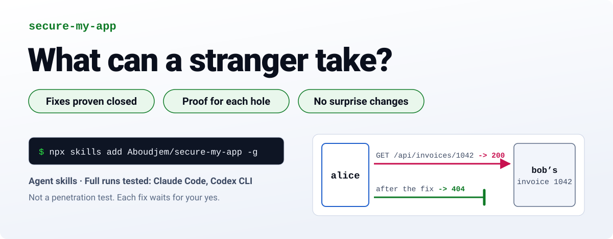

<p align="center">
  <picture>
    <source media="(prefers-color-scheme: dark)" srcset="https://raw.githubusercontent.com/Aboudjem/secure-my-app/main/assets/hero-dark.svg">
    
  </picture>
</p>

<p align="center">
  <a href="https://github.com/Aboudjem/secure-my-app/actions/workflows/validate.yml"></a> <a href="https://github.com/Aboudjem/secure-my-app/blob/main/LICENSE"></a>
</p>

<p align="center">
  <a href="../README.md">English</a> · <a href="zh-CN.md">简体中文</a> · <a href="ja.md">日本語</a> · <b>Español</b> · <a href="fr.md">Français</a>
  <br><sub>Esta traducción puede ir por detrás del original en inglés.<!-- may-lag --></sub>
</p>

<p align="center">
  <strong>Descubre qué puede llevarse un desconocido de tu aplicación. Después ciérralo y demuestra que está cerrado.</strong>
</p>

Lee tu aplicación, ejecuta 65 comprobaciones con nombre y muestra la prueba de cada agujero que reporta.

```bash
npx skills add Aboudjem/secure-my-app
```

Abre tu proyecto en tu agente y di:

```text
secure my app before I launch
```

## Qué obtienes

Escribe `.secure-my-app/report.md` y se detiene. Este es el inicio de un informe real, del 2026-11-17:

```text
VERDICT: DO NOT LAUNCH   coverage 21 checked / 2 unproven / 42 n/a   [static + live: 127.0.0.1:4310]
findings: 3 critical  2 high  6 medium  0 low   scan: gitleaks yes, semgrep installed but not run, osv-scanner no, trufflehog no
DO FIRST
1. K3  Replace the session secret committed in server.js with a new one read from the environment
2. D3  Replace SHA-256 password hashing with a real password hash, then reset every password
3. R10 Put a sign-in check and an admin role check on GET /admin/export
```

¿Puede un usuario leer la factura de otro cambiando un número en la URL? Aquí alice lee la de bob:

```text
HIGH R4 Any signed-in user can read any invoice by changing the number in the URL

WHERE   server.js:83-92 (the lookup is line 89)
PROOF   [static]   server.js:89   const invoice = invoices.find((i) => i.id === id);
        [executed] alice (team_1) reads bob's invoice:
                   GET /api/invoices/1042 -> 200 {"id":1042,"owner":"u_2","team":"team_2",...}
        [executed] the list route scopes correctly: alice GET /api/invoices -> 200, invoice 1041 only
IMPACT  One team's customers, billing contacts, amounts and IBAN digits, readable by the other team.
FIX     const invoice = invoices.find((i) => i.id === id && i.owner === user.id);
VERIFY  alice:  GET /api/invoices/1042 (bob's)   -> 404 "no such invoice"
        alice:  GET /api/invoices/1041 (hers)    -> 200, the invoice
STATUS  OPEN
```

Una corrección solo cuenta cuando esa misma petición deja de funcionar.
No es una prueba de penetración. Sin una URL en vivo, la mayoría de los controles de acceso vuelven `UNPROVEN`, y la única ejecución publicada es sobre una pequeña aplicación de prueba.

Lanzas el lunes. Construiste rápido, quizá con un agente.
No sabes si un usuario con sesión puede leer los datos de otro. Esto lo averigua y te muestra cómo lo sabe.

## Por qué usarlo

- **Pruebas, no suposiciones.** Cada hallazgo muestra su `PROOF`, marcada `[static]` para una línea de código o `[executed]` para un comando y su salida real. `make test` repite la prueba de los 11 hallazgos del ejemplo.
- **Una corrección que puedes comprobar.** Cada hallazgo tiene un comando `VERIFY` cuya salida debe cambiar. Los 11 hallazgos del [informe de ejemplo](https://github.com/Aboudjem/secure-my-app/blob/main/examples/sample-report.md) tienen uno: `grep -c '^VERIFY' examples/sample-report.md` imprime 11.
- **Tú mandas.** Escribe un informe y se detiene. Nada cambia en tu aplicación hasta que apruebes una corrección. El informe de ejemplo dice `Nothing in the app was changed.`

## Instalación

**Claude Code.** Añade el marketplace y luego instala el plugin.

```bash
claude plugin marketplace add Aboudjem/10x
```

```bash
claude plugin install secure-my-app@10x
```

**Cualquier otro agente.** El comando del CLI skills al inicio de esta página lo instala.
Después di `secure my app before I launch`.
Esa frase coincide con la descripción del skill, así que cualquier agente que cargue skills la reconoce.
En Codex CLI 0.169.0 inició el skill el 2026-11-17. Cada agente tiene además un disparador corto:

| Agente | Disparador corto |
| --- | --- |
| Claude Code | `/secure-my-app:secure-my-app` |
| Codex CLI | `$secure-my-app` |

Hace tres preguntas, lee tu código y escribe `.secure-my-app/report.md`. Después se detiene.

### Funciona con

| Agente | Qué se ejecutó | Probado |
| --- | --- | --- |
| Claude Code 2.1.326 | Plugin cargado, ejecución completa sobre la aplicación de prueba, [informe escrito](https://github.com/Aboudjem/secure-my-app/blob/main/examples/sample-report.md) | 2026-11-17 |
| Codex CLI 0.169.0 | `npx skills add -a codex`, ejecución completa sobre la aplicación de prueba, [informe escrito](https://github.com/Aboudjem/secure-my-app/blob/main/examples/sample-report-codex.md) | 2026-11-17 |

Documentados, sin probar: Cursor, GitHub Copilot, Gemini CLI, OpenCode, Windsurf, Zed, Continue.dev y Kimi Code CLI.
El CLI skills instala los mismos archivos para ellos. Aquí no consta ninguna ejecución en esos agentes.
Las rutas por agente están en [Instalar en tu editor](https://github.com/Aboudjem/secure-my-app/blob/main/docs/editors.md).

## Leer el informe

El informe empieza con el veredicto y después las tres cosas que hacer primero.
Bajo la cabecera, cada hallazgo tiene los mismos campos, como el bloque R4 al inicio de esta página.

- **De dónde sale.** La aplicación es [`examples/vulnerable-app/`](https://github.com/Aboudjem/secure-my-app/blob/main/examples/vulnerable-app/README.md), una pequeña API con agujeros dejados a propósito.
- **El informe completo.** [`examples/sample-report.md`](https://github.com/Aboudjem/secure-my-app/blob/main/examples/sample-report.md) es el archivo que escribió esa ejecución, sin editar. El bloque R4 de arriba es un extracto acortado.
- **`PROOF`** es la prueba. `[static]` es una línea leída en tu código. `[executed]` es un comando o una petición que se ejecutó, y la salida que dio, con los secretos recortados.
- **`VERIFY`** es el comando cuya salida debe cambiar para que una corrección cuente.
- **Segunda ejecución.** `.secure-my-app/surface.json` permite a la siguiente decir qué se corrigió, qué volvió y qué es nuevo.

Para una forma Supabase y Next.js, lee la [ilustración](https://github.com/Aboudjem/secure-my-app/blob/main/examples/illustration-supabase.md). Esa es inventada y lo dice.

### Pruébalo primero con la aplicación rota

Clona este repositorio y arranca la aplicación de prueba:

```bash
node examples/vulnerable-app/server.js
```

Abre tu agente en `examples/vulnerable-app/` y escribe la línea de tu agente:

```text
/secure-my-app:secure-my-app --report-only --live http://127.0.0.1:4310
```

En Codex CLI, empieza la misma línea con `$secure-my-app`.

El [README de la aplicación de prueba](https://github.com/Aboudjem/secure-my-app/blob/main/examples/vulnerable-app/README.md) tiene las tres respuestas y dos cuentas de prueba.

## Qué comprueba

65 controles en siete grupos, en el orden en que un atacante los prueba ([catálogo completo](https://github.com/Aboudjem/secure-my-app/blob/main/docs/controls.md)).

| Grupo | Cubre |
| --- | --- |
| KEYS (8) | Secretos en el repositorio, exposición de claves, alcance de claves, rotación |
| DOOR (9) | Inicio de sesión, sesiones, cookies, almacenamiento de contraseñas, tokens |
| ROOMS (10) | Seguridad a nivel de fila, IDOR, aislamiento entre inquilinos, asignación masiva |
| PIPES (13) | Inyección, XSS, CSRF, SSRF, CORS, redirecciones, webhooks, cabeceras |
| VAULT (8) | Cifrado en reposo, forma de las respuestas, fugas en errores, registros, copias de seguridad |
| FLOOR (10) | Límites de tasa, bots, subidas, manipulación de precios, funciones de IA |
| SUPPLY (7) | Dependencias, lockfiles, scripts de instalación, permisos de CI |

## Cómo funciona

- **Sin prueba, no hay hallazgo.** Lo que no puede resolver vuelve como `UNPROVEN`, nunca como aprobado.
- **Tú apruebas cada corrección.** Nada cambia en tu repositorio hasta que dices sí a esa corrección. No hay modo por lotes.
- **Cada corrección se prueba dos veces.** La petición del atacante ahora falla, y tu propio inicio de sesión sigue funcionando.
- **Una corrección que bloquea a todos se revierte.** Un parche que devuelve `403` a todos cierra el agujero y cierra también el producto.
- **No toca el historial ni las claves.** Nunca reescribe el historial de git ni rota una credencial. Escribe el procedimiento, tú lo ejecutas.

## Pruebas

Cada número de esta página sale de un comando que puedes ejecutar en un clon.

Los tests:

```bash
make test
```

```text
79/79 checks passed for skills/secure-my-app/SKILL.md
152/152 checks passed
54/54 checks passed
```

| Suite | Qué comprueba |
| --- | --- |
| `evals/check_skill.py` | El texto del skill: la escalera de pruebas, la línea de veredicto, las reglas RLS, la cabecera del informe |
| `tests/test_manifests.py` | Manifiestos, una sola versión en todas partes, archivos requeridos, este README |
| `tests/test_fixture.py` | Arranca la aplicación de prueba y repite la prueba de cada uno de los 11 hallazgos del ejemplo |

El número de controles:

```bash
grep -c '^| [KDRPVFS][0-9]' skills/secure-my-app/references/controls.md
```

```text
65
```

La CI ejecuta `make test` en cada push y cada pull request.
Los tests cubren el texto del skill y la aplicación de prueba. No pueden decirte qué encontrará una ejecución en tu aplicación.

## Preguntas frecuentes (FAQ)

### ¿Es seguro ejecutarlo en mi proyecto?

Sí. Solo lee hasta que apruebas una corrección. Lo único que escribe es el informe en `.secure-my-app/`.

### ¿Cambiará mi código?

No por sí solo. Cada corrección necesita tu sí, recibe antes un commit de control y se revierte si tu propia petición deja de funcionar.

### ¿Envía mi código a algún sitio?

No hace ninguna llamada de red propia. Con una URL y tu sí, envía unas 30 peticiones a ese único host.
Tu agente sigue enviando contexto a su proveedor de modelo, como en cualquier tarea.

### ¿Un informe limpio significa que mi aplicación es segura?

No. El tercer veredicto es `NOTHING CONFIRMED HERE`, siempre impreso con sus cifras de cobertura.
Significa que nada llegó a crítico o alto en lo que la ejecución pudo comprobar.

### ¿En qué se diferencia de `/security-review`?

`/security-review` lee un diff y encuentra el fallo en el código que escribiste.
secure-my-app lee toda la aplicación y encuentra la defensa que nadie escribió.

### ¿Necesito gitleaks o semgrep?

No. Los usa cuando están instalados y los nombra en la cabecera.
Un escáner ausente nunca convierte una comprobación en aprobada.

Hay más respuestas en las [FAQ completas](https://github.com/Aboudjem/secure-my-app/blob/main/docs/faq.md).

## Límites

- **No es una prueba de penetración.** Nadie firma el informe. Tampoco es una auditoría de cumplimiento.
- **Ve tu repositorio, no tu sistema.** Ajustes de la nube, DNS, portátiles y personas quedan fuera.
- **Dos ejecuciones pueden diferir.** La calificación es una tabla fija. El análisis es el juicio de un agente.
- **Una sola ejecución registrada.** El ejemplo viene de una pequeña aplicación de prueba. No se publica aquí ninguna ejecución sobre una aplicación en producción.
- **Sin URL prueba menos.** La mayoría de los controles de acceso vuelven entonces `UNPROVEN`.
- **Las sondas en vivo están acotadas.** Unas 30 peticiones, un único host tuyo, sin `DELETE`, sin pruebas de carga.

Todo lo que no promete está en [Límites honestos](https://github.com/Aboudjem/secure-my-app/blob/main/docs/limits.md).

## Para saber más

- [Inicio rápido](https://github.com/Aboudjem/secure-my-app/blob/main/docs/quickstart.md), una primera ejecución de principio a fin
- [Un informe de una ejecución real](https://github.com/Aboudjem/secure-my-app/blob/main/examples/sample-report.md), once hallazgos y el anexo de lo no probado
- [Instalar en tu editor](https://github.com/Aboudjem/secure-my-app/blob/main/docs/editors.md) · [Contribuir](https://github.com/Aboudjem/secure-my-app/blob/main/CONTRIBUTING.md) · [El skill en sí](https://github.com/Aboudjem/secure-my-app/blob/main/skills/secure-my-app/SKILL.md)

---

<sub>Creado por <a href="https://github.com/Aboudjem">Adam Boudjemaa</a> · MIT.
Catálogo de controles, matriz de severidad y semántica RLS derivados de nuevo de la documentación primaria de PostgreSQL, Supabase y OWASP, 2026.
Hermano de <a href="https://github.com/Aboudjem/loopify">loopify</a> y <a href="https://github.com/Aboudjem/goalify">goalify</a>. <a href="https://github.com/Aboudjem/secure-my-app/issues">¿Ves un hueco?</a></sub>

<sub>Traducción asistida por máquina. La versión de referencia es el <a href="../README.md">README.md</a> en inglés.</sub>
