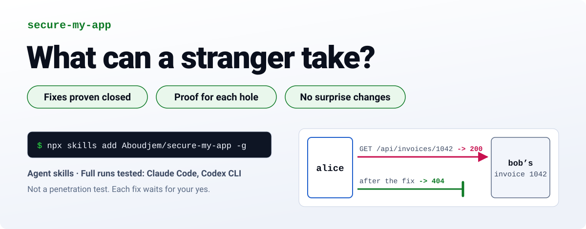

<p align="center">
  <picture>
    <source media="(prefers-color-scheme: dark)" srcset="https://raw.githubusercontent.com/Aboudjem/secure-my-app/main/assets/hero-dark.svg">
    
  </picture>
</p>

<p align="center">
  <a href="https://github.com/Aboudjem/secure-my-app/actions/workflows/validate.yml"></a> <a href="https://github.com/Aboudjem/secure-my-app/blob/main/LICENSE"></a>
</p>

<p align="center">
  <a href="../README.md">English</a> · <a href="zh-CN.md">简体中文</a> · <a href="ja.md">日本語</a> · <a href="es.md">Español</a> · <b>Français</b>
  <br><sub>Cette traduction peut avoir du retard sur l'original en anglais.<!-- may-lag --></sub>
</p>

<p align="center">
  <strong>Trouvez ce qu'un inconnu peut prendre dans votre application.</strong>
</p>

Il applique 65 contrôles nommés et montre la preuve de chaque faille qu'il signale.

| Corrections prouvées | Une preuve par faille | Aucun changement surprise |
|:--|:--|:--|
| Une correction ne compte que si la sortie de VERIFY change. Les 11 constats de l'exemple en ont une. | Chaque constat montre sa preuve. `make test` rejoue la preuve des 11 constats de l'exemple. | Il écrit un rapport et s'arrête. Chaque correction attend votre oui. |

**Fonctionne avec :** tout agent qui lit les skills. Exécutions complètes testées : Claude Code, Codex CLI. C'est un skill en Markdown, il n'est donc lié à aucun modèle.

```bash
npx skills add Aboudjem/secure-my-app -g
# then, in your agent: secure my app before I launch
```

Le début d'un vrai rapport, issu d'une exécution sur la petite application d'essai de ce dépôt, le 2026-11-17 :

```text
VERDICT: DO NOT LAUNCH   coverage 21 checked / 2 unproven / 42 n/a   [static + live: 127.0.0.1:4310]
findings: 3 critical  2 high  6 medium  0 low   scan: gitleaks yes, semgrep installed but not run, osv-scanner no, trufflehog no
DO FIRST
1. K3  Replace the session secret committed in server.js with a new one read from the environment
2. D3  Replace SHA-256 password hashing with a real password hash, then reset every password
3. R10 Put a sign-in check and an admin role check on GET /admin/export
```

Un utilisateur peut-il lire la facture d'un autre en changeant un nombre dans l'URL ? Ici, alice lit celle de bob :

```text
HIGH R4 Any signed-in user can read any invoice by changing the number in the URL

WHERE   server.js:83-92 (the lookup is line 89)
PROOF   [static]   server.js:89   const invoice = invoices.find((i) => i.id === id);
        [executed] alice (team_1) reads bob's invoice:
                   GET /api/invoices/1042 -> 200 {"id":1042,"owner":"u_2","team":"team_2",...}
        [executed] the list route scopes correctly: alice GET /api/invoices -> 200, invoice 1041 only
IMPACT  One team's customers, billing contacts, amounts and IBAN digits, readable by the other team.
FIX     const invoice = invoices.find((i) => i.id === id && i.owner === user.id);
VERIFY  alice:  GET /api/invoices/1042 (bob's)   -> 404 "no such invoice"
        alice:  GET /api/invoices/1041 (hers)    -> 200, the invoice
STATUS  OPEN
```

**Ce que c'est :** un skill qui cherche les failles de sécurité de votre application.
**Quand l'utiliser :** avant le lancement, ou avant que des inconnus puissent s'inscrire.
**Ce que vous obtenez :** un rapport avec la preuve de chaque faille. Votre code reste tel quel.

**Limite :** ce n'est pas un test d'intrusion (une attaque payée, faite par un expert). Sans URL en ligne, la plupart des contrôles d'accès restent `UNPROVEN`.

## Installation

**Choisissez votre agent.** Chaque commande installe secure-my-app pour tous vos projets.

<p align="center">
  <a href="#install-claude-code"></a>
  <a href="#install-codex"></a>
  <a href="#install-cursor"></a>
  <a href="#install-gemini-cli"></a>
  <a href="#install-github-copilot"></a>
  <a href="#install-opencode"></a>
</p>

<a id="install-claude-code"></a>**Claude Code**, testé. Installe pour tous vos projets :

```bash
claude plugin marketplace add Aboudjem/10x && claude plugin install secure-my-app@10x
```

<a id="install-codex"></a>**Codex**, testé :

```bash
npx skills add Aboudjem/secure-my-app -g -a codex
```

<a id="install-cursor"></a>**Cursor**, installation testée :

```bash
npx skills add Aboudjem/secure-my-app -g -a cursor
```

<a id="install-gemini-cli"></a>**Gemini CLI**, installation testée :

```bash
npx skills add Aboudjem/secure-my-app -g -a gemini-cli
```

<a id="install-github-copilot"></a>**GitHub Copilot**, installation testée :

```bash
npx skills add Aboudjem/secure-my-app -g -a github-copilot
```

<a id="install-opencode"></a>**OpenCode**, installation testée :

```bash
npx skills add Aboudjem/secure-my-app -g -a opencode
```

Pour ce projet seulement : retirez `-g`. Autre agent : son code `-a` est dans [Installer dans votre éditeur](https://github.com/Aboudjem/secure-my-app/blob/main/docs/editors.md).

**Votre première commande.** Ouvrez votre projet dans votre agent et dites :

```text
secure my app before I launch
```

1. Il pose trois questions.
2. Il lit votre code et écrit `.secure-my-app/report.md`.
3. Il s'arrête. Rien ne change avant votre oui à une correction.

Cette phrase correspond à la description du skill, donc tout agent qui charge les skills la reconnaît.
Chaque agent a aussi un déclencheur court :

| Agent | Déclencheur court |
| --- | --- |
| Claude Code | `/secure-my-app:secure-my-app` |
| Codex CLI | `$secure-my-app` |

### Fonctionne avec

| Agent | Ce qui a tourné | Testé |
| --- | --- | --- |
| Claude Code 2.1.326 | Plugin chargé, exécution complète sur l'application d'essai, [rapport écrit](https://github.com/Aboudjem/secure-my-app/blob/main/examples/sample-report.md) | 2026-11-17 |
| Codex CLI 0.169.0 | `npx skills add -a codex`, exécution complète sur l'application d'essai, [rapport écrit](https://github.com/Aboudjem/secure-my-app/blob/main/examples/sample-report-codex.md) | 2026-11-17 |
| Claude Code (installation seule) | La commande du plugin ci-dessus, dans un dossier personnel vide : installé avec la portée user | 2026-11-17 |
| Cursor, Gemini CLI, GitHub Copilot, OpenCode (installation seule) | La commande `-g -a` ci-dessus, dans un dossier personnel vide : fichiers dans `~/.agents/skills/secure-my-app` | 2026-11-17 |

« Installation seule » veut dire que les fichiers sont arrivés là où l'agent les lit. Aucune exécution complète sur ces agents n'est enregistrée ici.
Documentés, non testés : Windsurf, Zed, Continue.dev et Kimi Code CLI.
Les chemins par agent sont dans [Installer dans votre éditeur](https://github.com/Aboudjem/secure-my-app/blob/main/docs/editors.md).

## Lire le rapport

Le rapport s'ouvre sur le verdict, puis sur les trois choses à faire d'abord.
Sous l'en-tête, chaque constat a les mêmes champs, comme le bloc R4 en haut de cette page.

- **D'où il vient.** L'application est [`examples/vulnerable-app/`](https://github.com/Aboudjem/secure-my-app/blob/main/examples/vulnerable-app/README.md), une petite API avec des failles laissées exprès.
- **Le rapport entier.** [`examples/sample-report.md`](https://github.com/Aboudjem/secure-my-app/blob/main/examples/sample-report.md) est le fichier écrit par cette exécution, non modifié. Le bloc R4 ci-dessus en est un extrait raccourci.
- **`PROOF`** est la preuve. `[static]` est une ligne lue dans votre code. `[executed]` est une commande ou une requête exécutée, et la sortie obtenue, secrets tronqués.
- **`VERIFY`** est la commande dont la sortie doit changer pour qu'une correction compte.
- **Deuxième exécution.** `.secure-my-app/surface.json` permet à la suivante de dire ce qui a été corrigé, ce qui est revenu et ce qui est nouveau.

Pour une forme Supabase et Next.js, lisez l'[illustration](https://github.com/Aboudjem/secure-my-app/blob/main/examples/illustration-supabase.md). Celle-là est inventée et le dit.

### Essayez d'abord sur l'application cassée

Clonez ce dépôt, puis démarrez l'application d'essai :

```bash
node examples/vulnerable-app/server.js
```

Ouvrez votre agent dans `examples/vulnerable-app/` et tapez la ligne de votre agent :

```text
/secure-my-app:secure-my-app --report-only --live http://127.0.0.1:4310
```

Dans Codex CLI, commencez la même ligne par `$secure-my-app`.

Le [README de l'application d'essai](https://github.com/Aboudjem/secure-my-app/blob/main/examples/vulnerable-app/README.md) donne les trois réponses et deux comptes de test.

## Ce qu'il vérifie

Vous lancez lundi. Vous avez construit vite, peut-être avec un agent.
Un utilisateur connecté peut-il lire les données d'un autre ? Ce skill vérifie, et vous montre la preuve.

65 contrôles en sept groupes, dans l'ordre où un attaquant les essaie ([catalogue complet](https://github.com/Aboudjem/secure-my-app/blob/main/docs/controls.md)).

| Groupe | Couvre |
| --- | --- |
| KEYS (8) | Secrets dans le dépôt, exposition des clés, portée des clés, rotation |
| DOOR (9) | Connexion, sessions, cookies, stockage des mots de passe, jetons |
| ROOMS (10) | Sécurité au niveau des lignes, IDOR, isolation des locataires, affectation de masse |
| PIPES (13) | Injection, XSS, CSRF, SSRF, CORS, redirections, webhooks, en-têtes |
| VAULT (8) | Chiffrement au repos, forme des réponses, fuites d'erreurs, journaux, sauvegardes |
| FLOOR (10) | Limites de débit, bots, envois de fichiers, manipulation des prix, fonctions IA |
| SUPPLY (7) | Dépendances, fichiers de verrouillage, scripts d'installation, permissions CI |

## Comment ça marche

Le résumé du skill lui-même : **trouvez ce qu'un inconnu peut prendre dans votre application, puis refermez-le et prouvez que c'est refermé.**
La partie correction ne commence qu'avec votre oui. Une correction ne compte que si cette même requête échoue.

- **Pas de preuve, pas de constat.** Ce qu'il ne peut pas trancher revient `UNPROVEN`, jamais comme une réussite.
- **Vous approuvez chaque correction.** Rien ne change dans votre dépôt avant votre oui à cette correction précise. Il n'y a pas de mode par lot.
- **Chaque correction est prouvée deux fois.** La requête de l'attaquant échoue désormais, et votre propre connexion marche toujours.
- **Une correction qui bloque tout le monde est annulée.** Un correctif qui renvoie `403` à tous ferme la faille et ferme aussi le produit.
- **Il ne touche ni à l'historique ni aux clés.** Il ne réécrit jamais l'historique git et ne fait jamais tourner un identifiant. Il écrit la procédure, vous l'exécutez.

## Preuves

Chaque nombre de cette page vient d'une commande que vous pouvez lancer dans un clone.

Les tests :

```bash
make test
```

```text
79/79 checks passed for skills/secure-my-app/SKILL.md
152/152 checks passed
54/54 checks passed
```

| Suite | Ce qu'elle vérifie |
| --- | --- |
| `evals/check_skill.py` | Le texte du skill : l'échelle de preuve, la ligne de verdict, les règles RLS, l'en-tête du rapport |
| `tests/test_manifests.py` | Manifestes, une seule version partout, fichiers requis, ce README |
| `tests/test_fixture.py` | Démarre l'application d'essai et rejoue la preuve de chacun des 11 constats de l'exemple |

Les lignes `VERIFY` du rapport d'exemple, une par constat :

```bash
grep -c '^VERIFY' examples/sample-report.md
```

```text
11
```

L'exécution de l'exemple n'a rien changé : son en-tête dit `Nothing in the app was changed.`

Le nombre de contrôles :

```bash
grep -c '^| [KDRPVFS][0-9]' skills/secure-my-app/references/controls.md
```

```text
65
```

La CI lance `make test` à chaque push et à chaque pull request.
Les tests couvrent le texte du skill et l'application d'essai. Ils ne peuvent pas vous dire ce qu'une exécution trouvera dans votre application.

## FAQ

### Est-ce sûr de le lancer sur mon projet ?

Oui. Il ne fait que lire jusqu'à ce que vous approuviez une correction. La seule chose qu'il écrit est le rapport sous `.secure-my-app/`.

### Va-t-il modifier mon code ?

Pas de lui-même. Chaque correction demande votre oui, reçoit d'abord un commit de sauvegarde, et est annulée si votre propre requête cesse de marcher.

### Envoie-t-il mon code quelque part ?

Il ne fait aucun appel réseau de lui-même. Avec une URL et votre oui, il envoie environ 30 requêtes à ce seul hôte.
Votre agent envoie toujours du contexte à son propre fournisseur de modèle, comme pour toute tâche.

### Un rapport propre veut-il dire que mon application est sûre ?

Non. Le troisième verdict est `NOTHING CONFIRMED HERE`, toujours imprimé avec ses chiffres de couverture.
Il veut dire que rien n'a atteint critique ou élevé dans ce que l'exécution a pu vérifier.

### En quoi est-ce différent de `/security-review` ?

`/security-review` lit un diff et trouve la faille dans le code que vous avez écrit.
secure-my-app lit toute l'application et trouve la défense que personne n'a écrite.

### Ai-je besoin de gitleaks ou de semgrep ?

Non. Il les utilise quand ils sont installés et les nomme dans l'en-tête.
Un scanner absent ne transforme jamais un contrôle en réussite.

D'autres réponses sont dans la [FAQ complète](https://github.com/Aboudjem/secure-my-app/blob/main/docs/faq.md).

## Limites

- **Ce n'est pas un test d'intrusion** (une attaque payée, faite par un expert). Personne ne signe le rapport. Ce n'est pas non plus un audit de conformité.
- **Il voit votre dépôt, pas votre système.** Réglages cloud, DNS, ordinateurs portables et personnes sont hors de sa portée.
- **Deux exécutions peuvent différer.** La notation est une table fixe. L'analyse est le jugement d'un agent.
- **Une seule exécution enregistrée.** La seule exécution publiée porte sur une petite application d'essai. Aucune exécution sur une application en production n'est publiée ici.
- **Sans URL, il prouve moins.** Sans URL en ligne, la plupart des contrôles d'accès restent `UNPROVEN`.
- **Les sondes en ligne sont bornées.** Environ 30 requêtes, un seul hôte qui vous appartient, pas de `DELETE`, pas de test de charge.

Tout ce qu'il ne promet pas est dans [Limites honnêtes](https://github.com/Aboudjem/secure-my-app/blob/main/docs/limits.md).

## Pour aller plus loin

- [Démarrage rapide](https://github.com/Aboudjem/secure-my-app/blob/main/docs/quickstart.md), une première exécution du début à la fin
- [Un rapport issu d'une vraie exécution](https://github.com/Aboudjem/secure-my-app/blob/main/examples/sample-report.md), onze constats et l'annexe des contrôles non prouvés
- [Installer dans votre éditeur](https://github.com/Aboudjem/secure-my-app/blob/main/docs/editors.md) · [Contribuer](https://github.com/Aboudjem/secure-my-app/blob/main/CONTRIBUTING.md) · [Le skill lui-même](https://github.com/Aboudjem/secure-my-app/blob/main/skills/secure-my-app/SKILL.md)

---

<sub>Créé par <a href="https://github.com/Aboudjem">Adam Boudjemaa</a> · MIT.
Catalogue de contrôles, matrice de sévérité et sémantique RLS redérivés des documentations primaires PostgreSQL, Supabase et OWASP, 2026.
Frère de <a href="https://github.com/Aboudjem/loopify">loopify</a> et de <a href="https://github.com/Aboudjem/goalify">goalify</a>. <a href="https://github.com/Aboudjem/secure-my-app/issues">Une lacune repérée ?</a></sub>

<sub>Traduction assistée par machine. La version de référence est le <a href="../README.md">README.md</a> en anglais.</sub>
