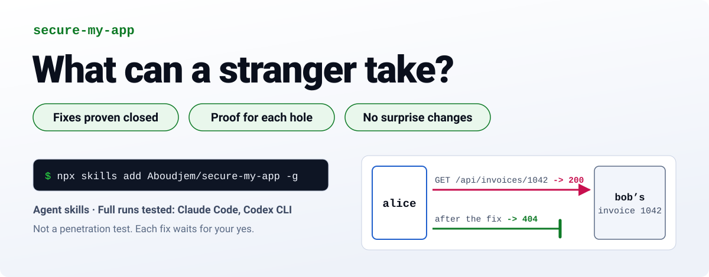

<p align="center">
  <picture>
    <source media="(prefers-color-scheme: dark)" srcset="https://raw.githubusercontent.com/Aboudjem/secure-my-app/main/assets/hero-dark.svg">
    
  </picture>
</p>

<p align="center">
  <a href="https://github.com/Aboudjem/secure-my-app/actions/workflows/validate.yml"></a> <a href="https://github.com/Aboudjem/secure-my-app/blob/main/LICENSE"></a>
</p>

<p align="center">
  <a href="../README.md">English</a> · <a href="zh-CN.md">简体中文</a> · <b>日本語</b> · <a href="es.md">Español</a> · <a href="fr.md">Français</a>
  <br><sub>この翻訳は英語の原文より古い場合があります。<!-- may-lag --></sub>
</p>

<p align="center">
  <strong>見知らぬ他人があなたのアプリから何を持ち出せるかを見つけてください。そしてそれを塞ぎ、塞がったことを証明してください。</strong>
</p>

## できること

- 差分ではなくアプリ全体を読み、名前の付いた 65 個のセキュリティチェックを実行します。
- 穴を報告するのは、それを証明するコマンドとその実際の出力があるときだけです。
- 修正は一つずつ、あなたがその修正を承認してから行い、塞がったことを毎回証明し直します。

## インストール

```bash
claude plugin marketplace add Aboudjem/10x
claude plugin install secure-my-app@10x       # Claude Code
npx skills add Aboudjem/secure-my-app         # Cursor, Codex, Copilot, Gemini CLI, 70+ others
```

## 手に入るもの

`.secure-my-app/report.md` は判定行から始まり、どの検出結果も同じ 7 つの項目を同じ順番で持ちます。

```text
SECURE-MY-APP   gate: DO NOT LAUNCH
coverage 47 checked / 8 unproven / 4 n/a   [static + live: tidemark-preview.vercel.app]
findings: 2 critical  1 high  1 medium  0 low
CRITICAL  R1  Anyone can read every row of bookings
WHAT     Row level security is off on public.bookings, so the publishable key reads it all.
WHERE    supabase/migrations/0002_bookings.sql:11
PROOF    [executed] curl -s "$URL/rest/v1/bookings?select=*" -H "apikey: sb_publishable_7f2a..."
                    -> 200, 1204 rows: id, user_id, email, phone, address_line1, total_cents
IMPACT   Every customer's email, phone, address and what they paid, to anyone with devtools.
FIX      alter table public.bookings enable row level security;
         create policy "own" on public.bookings for select to authenticated
           using ((select auth.uid()) = user_id);
VERIFY   anon curl returns []; user A reads their own row; user B gets empty, not an error.
STATUS   OPEN
```

`PROOF` は実際のコマンドとその実際の出力で、秘密情報は伏せてあります。`VERIFY` は、何かを修正済みと呼ぶ前に
出力が変わっていなければならないコマンドです。`.secure-my-app/surface.json` があるので、2 回目の実行は差分になります。

## 何をチェックするか

攻撃者が試す順に並んだ 7 グループ、65 個のコントロールです ([カタログ全体](https://github.com/Aboudjem/secure-my-app/blob/main/docs/controls.md))。

| グループ | 対象 |
| --- | --- |
| KEYS (8) | リポジトリ内の秘密情報、鍵の露出、鍵の権限範囲、ローテーション |
| DOOR (9) | ログイン、セッション、クッキー、パスワードの保存、トークン |
| ROOMS (10) | 行レベルセキュリティ、IDOR、テナント分離、マスアサインメント |
| PIPES (13) | インジェクション、XSS、CSRF、SSRF、CORS、リダイレクト、Webhook、ヘッダー |
| VAULT (8) | 保存時の暗号化、レスポンスの形、エラーからの漏洩、ログ、バックアップ |
| FLOOR (10) | レート制限、ボット、アップロード、価格の改ざん、AI 機能 |
| SUPPLY (7) | 依存関係、ロックファイル、インストールスクリプト、CI の権限 |

## 仕組み

- 証拠がなければ報告しません。ここで判断できなかったものは `UNPROVEN` として返り、合格にはなりません。
- あなたがその修正を承認するまで、リポジトリは一切変わりません。まとめて承認するモードはありません。
- どの修正も反対向きの 2 方向で証明します。攻撃者のリクエストは失敗し、あなた自身のログインは今までどおり通ります。
  全員に `403` を返すパッチは、穴を塞ぐと同時に製品も塞ぎます。
- git の履歴を書き換えることも、認証情報をローテーションすることもありません。手順書を書くのはこのスキル、実行するのはあなたです。

## 知っておくとよいこと

- 何も出なかった実行は、アプリが安全だという証明ではありません。3 番目の判定は `NOTHING CONFIRMED HERE`
  という言葉で、カバレッジの件数なしに表示されることはありません。その実行で確認できた範囲では
  CRITICAL と HIGH に達したものがなかった、と言っているだけです。
- 修正を承認するまでは読み取り専用です。あなたが明示的に許可した場合に限り、あなたが所有を確認した
  1 つのホストに対して、無害なリクエストを最大 30 回程度送ります。`DELETE` も負荷試験もしません。
- ペネトレーションテストではなく、誰も署名しません。残りは [正直な限界](https://github.com/Aboudjem/secure-my-app/blob/main/docs/limits.md) にあります。

## もっと詳しく

- [クイックスタート](https://github.com/Aboudjem/secure-my-app/blob/main/docs/quickstart.md)、最初の 1 回を最初から最後まで
- [完成したレポート](https://github.com/Aboudjem/secure-my-app/blob/main/examples/sample-report.md)、11 件の検出結果と未確定の付録
- [正直な限界](https://github.com/Aboudjem/secure-my-app/blob/main/docs/limits.md)、secure-my-app が約束しないことすべて
- [各エディタでのインストール](https://github.com/Aboudjem/secure-my-app/blob/main/docs/editors.md) · [FAQ](https://github.com/Aboudjem/secure-my-app/blob/main/docs/faq.md) · [コントリビュート](https://github.com/Aboudjem/secure-my-app/blob/main/CONTRIBUTING.md) · [スキル本体](https://github.com/Aboudjem/secure-my-app/blob/main/skills/secure-my-app/SKILL.md)

---

<sub>作者 <a href="https://github.com/Aboudjem">Adam Boudjemaa</a> · MIT。CI で 162 件のチェックにより検証しています (<code>tests/test_manifests.py</code> から 90 件、<code>evals/check_skill.py</code> から 72 件)。
コントロールカタログ、深刻度マトリクス、RLS のセマンティクスは PostgreSQL、Supabase、OWASP の一次資料から再導出しています (2026 年)。<a href="https://github.com/Aboudjem/loopify">loopify</a> と <a href="https://github.com/Aboudjem/goalify">goalify</a> の姉妹プロジェクトです。<a href="https://github.com/Aboudjem/secure-my-app/issues">抜けを見つけましたか?</a></sub>

<sub>機械翻訳のうえで校正しています。基準となるのは英語の <a href="../README.md">README.md</a> です。</sub>
