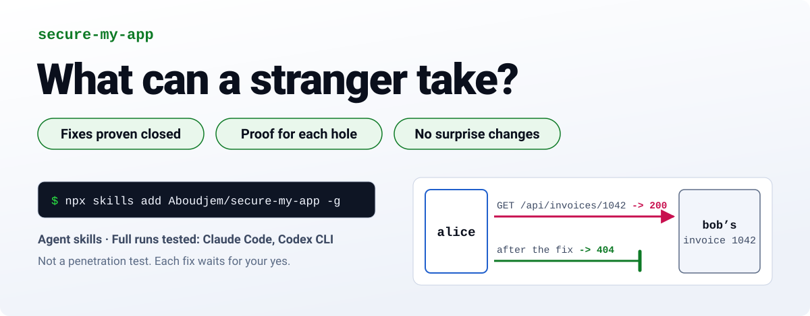

<p align="center">
  <picture>
    <source media="(prefers-color-scheme: dark)" srcset="https://raw.githubusercontent.com/Aboudjem/secure-my-app/main/assets/hero-dark.svg">
    
  </picture>
</p>

<p align="center">
  <a href="https://github.com/Aboudjem/secure-my-app/actions/workflows/validate.yml"></a> <a href="https://github.com/Aboudjem/secure-my-app/blob/main/LICENSE"></a>
</p>

<p align="center">
  <a href="../README.md">English</a> · <b>简体中文</b> · <a href="ja.md">日本語</a> · <a href="es.md">Español</a> · <a href="fr.md">Français</a>
  <br><sub>本翻译可能落后于英文原文。<!-- may-lag --></sub>
</p>

<p align="center">
  <strong>找出陌生人能从你的应用里拿走什么。</strong>
</p>

它运行 65 项有名称的检查，并为报告的每个漏洞给出证据。

| 修复有证明 | 每个漏洞都有证据 | 不会擅自改动 |
|:--|:--|:--|
| 只有 VERIFY 的输出改变，修复才算数。示例中的 11 条发现都有。 | 每条发现都给出证据。`make test` 会重放示例中全部 11 条发现的证据。 | 它写出报告后就停下。每项修复都等你同意。 |

**适用于：** 任何能读取技能的智能体。完整运行已测试：Claude Code、Codex CLI。它是一个 Markdown 技能，所以不绑定任何一个模型。

```bash
npx skills add Aboudjem/secure-my-app -g
# then, in your agent: secure my app before I launch
```

一份真实报告的开头，来自 2026-11-17 在本仓库小型测试应用上的一次运行：

```text
VERDICT: DO NOT LAUNCH   coverage 21 checked / 2 unproven / 42 n/a   [static + live: 127.0.0.1:4310]
findings: 3 critical  2 high  6 medium  0 low   scan: gitleaks yes, semgrep installed but not run, osv-scanner no, trufflehog no
DO FIRST
1. K3  Replace the session secret committed in server.js with a new one read from the environment
2. D3  Replace SHA-256 password hashing with a real password hash, then reset every password
3. R10 Put a sign-in check and an admin role check on GET /admin/export
```

改一下 URL 里的数字，一个用户能读到别人的发票吗？这里 alice 读到了 bob 的：

```text
HIGH R4 Any signed-in user can read any invoice by changing the number in the URL

WHERE   server.js:83-92 (the lookup is line 89)
PROOF   [static]   server.js:89   const invoice = invoices.find((i) => i.id === id);
        [executed] alice (team_1) reads bob's invoice:
                   GET /api/invoices/1042 -> 200 {"id":1042,"owner":"u_2","team":"team_2",...}
        [executed] the list route scopes correctly: alice GET /api/invoices -> 200, invoice 1041 only
IMPACT  One team's customers, billing contacts, amounts and IBAN digits, readable by the other team.
FIX     const invoice = invoices.find((i) => i.id === id && i.owner === user.id);
VERIFY  alice:  GET /api/invoices/1042 (bob's)   -> 404 "no such invoice"
        alice:  GET /api/invoices/1041 (hers)    -> 200, the invoice
STATUS  OPEN
```

**它是什么：** 一个查找你应用中安全漏洞的技能。
**何时使用：** 在上线之前，或在陌生人可以注册之前。
**你得到什么：** 一份报告，每个漏洞都附有证据。你的代码保持原样。

**局限：** 它不是渗透测试（由专家进行的付费攻击测试）。没有在线 URL 时，大多数访问检查保持 `UNPROVEN`。

## 安装

**选择你的智能体。** 每条命令都会为你的所有项目安装 secure-my-app。

<p align="center">
  <a href="#install-claude-code"></a>
  <a href="#install-codex"></a>
  <a href="#install-cursor"></a>
  <a href="#install-gemini-cli"></a>
  <a href="#install-github-copilot"></a>
  <a href="#install-opencode"></a>
</p>

<a id="install-claude-code"></a>**Claude Code**，已测试。为你的所有项目安装：

```bash
claude plugin marketplace add Aboudjem/10x && claude plugin install secure-my-app@10x
```

<a id="install-codex"></a>**Codex**，已测试：

```bash
npx skills add Aboudjem/secure-my-app -g -a codex
```

<a id="install-cursor"></a>**Cursor**，已测试安装：

```bash
npx skills add Aboudjem/secure-my-app -g -a cursor
```

<a id="install-gemini-cli"></a>**Gemini CLI**，已测试安装：

```bash
npx skills add Aboudjem/secure-my-app -g -a gemini-cli
```

<a id="install-github-copilot"></a>**GitHub Copilot**，已测试安装：

```bash
npx skills add Aboudjem/secure-my-app -g -a github-copilot
```

<a id="install-opencode"></a>**OpenCode**，已测试安装：

```bash
npx skills add Aboudjem/secure-my-app -g -a opencode
```

只装在当前项目：去掉 `-g`。其他智能体：它的 `-a` 代码见[在编辑器中安装](https://github.com/Aboudjem/secure-my-app/blob/main/docs/editors.md)。

**你的第一条命令。** 在智能体中打开你的项目，然后说：

```text
secure my app before I launch
```

1. 它问三个问题。
2. 它读取你的代码并写出 `.secure-my-app/report.md`。
3. 它停下。在你同意某项修复之前，什么都不会改变。

这句话与技能的描述相符，所以任何加载技能的智能体都能识别。
每个智能体也有一个短触发词：

| 智能体 | 短触发词 |
| --- | --- |
| Claude Code | `/secure-my-app:secure-my-app` |
| Codex CLI | `$secure-my-app` |

### 适用于

| 智能体 | 运行内容 | 测试日期 |
| --- | --- | --- |
| Claude Code 2.1.326 | 加载插件，在测试应用上完整运行，[写出报告](https://github.com/Aboudjem/secure-my-app/blob/main/examples/sample-report.md) | 2026-11-17 |
| Codex CLI 0.169.0 | `npx skills add -a codex`，在测试应用上完整运行，[写出报告](https://github.com/Aboudjem/secure-my-app/blob/main/examples/sample-report-codex.md) | 2026-11-17 |
| Claude Code（仅安装） | 上面的插件命令，装入空的主目录：以 user 范围安装 | 2026-11-17 |
| Cursor、Gemini CLI、GitHub Copilot、OpenCode（仅安装） | 上面的 `-g -a` 命令，装入空的主目录：文件在 `~/.agents/skills/secure-my-app` | 2026-11-17 |

“仅安装”表示文件已放到智能体读取的位置。这里没有记录这些智能体上的完整运行。
已有文档、未测试：Windsurf、Zed、Continue.dev 和 Kimi Code CLI。
各智能体的路径见[在编辑器中安装](https://github.com/Aboudjem/secure-my-app/blob/main/docs/editors.md)。

## 阅读报告

报告以结论开头，然后是最先要做的三件事。
在标题之下，每条发现都有相同的字段，就像本页顶部的 R4 块。

- **来源。** 应用是 [`examples/vulnerable-app/`](https://github.com/Aboudjem/secure-my-app/blob/main/examples/vulnerable-app/README.md)，一个故意留有漏洞的小型 API。
- **完整报告。** [`examples/sample-report.md`](https://github.com/Aboudjem/secure-my-app/blob/main/examples/sample-report.md) 是那次运行写出的文件，未经编辑。上面的 R4 块是从中缩短的。
- **`PROOF`** 是证据。`[static]` 是从你的代码中读到的一行。`[executed]` 是一个实际运行的命令或请求及其输出，机密已截短。
- **`VERIFY`** 是修复生效前输出必须改变的命令。
- **第二次运行。** `.secure-my-app/surface.json` 让下一次运行说出哪些已修复、哪些又出现、哪些是新的。

关于 Supabase 加 Next.js 的形态，请看[示意报告](https://github.com/Aboudjem/secure-my-app/blob/main/examples/illustration-supabase.md)。那份是虚构的，并且注明了。

### 先在有漏洞的应用上试试

克隆本仓库，然后启动测试应用：

```bash
node examples/vulnerable-app/server.js
```

在 `examples/vulnerable-app/` 中打开你的智能体，输入对应你智能体的那一行：

```text
/secure-my-app:secure-my-app --report-only --live http://127.0.0.1:4310
```

在 Codex CLI 中，把同一行改为以 `$secure-my-app` 开头。

[测试应用的 README](https://github.com/Aboudjem/secure-my-app/blob/main/examples/vulnerable-app/README.md) 给出了三个答案和两个测试账号。

## 检查什么

你周一上线。你做得很快，也许用了智能体。
一个已登录用户能读到另一个用户的数据吗？这个技能会检查，并给你看证据。

65 项控制分为七组，按攻击者尝试的顺序排列（[完整目录](https://github.com/Aboudjem/secure-my-app/blob/main/docs/controls.md)）。

| 组 | 涵盖 |
| --- | --- |
| KEYS (8) | 仓库中的机密、密钥暴露、密钥权限范围、轮换 |
| DOOR (9) | 登录、会话、Cookie、密码存储、令牌 |
| ROOMS (10) | 行级安全、IDOR、租户隔离、批量赋值 |
| PIPES (13) | 注入、XSS、CSRF、SSRF、CORS、重定向、Webhook、响应头 |
| VAULT (8) | 静态加密、响应结构、错误泄露、日志、备份 |
| FLOOR (10) | 速率限制、机器人、上传、价格篡改、AI 功能 |
| SUPPLY (7) | 依赖、锁文件、安装脚本、CI 权限 |

## 工作原理

技能自己的概括：**找出陌生人能从你的应用里拿走什么，然后把它堵上，并证明它确实堵上了。**
只有在你同意某项修复后，才会开始堵漏洞。只有同一个请求失败了，修复才算数。

- **没有证据，就没有发现。** 无法定论的项目返回 `UNPROVEN`，绝不算作通过。
- **每项修复都由你批准。** 在你同意那一项修复之前，仓库不会有任何改动。没有批量模式。
- **每项修复都证明两次。** 攻击者的请求现在失败，而你自己的登录仍然有效。
- **把所有人都挡在外面的修复会被撤销。** 对所有用户返回 `403` 的补丁堵住了漏洞，也关掉了产品。
- **不碰历史记录和密钥。** 它从不改写 git 历史，也从不轮换凭据。它写出操作手册，由你执行。

## 证据

本页的每个数字都来自你可以在克隆中运行的命令。

测试：

```bash
make test
```

```text
79/79 checks passed for skills/secure-my-app/SKILL.md
152/152 checks passed
54/54 checks passed
```

| 测试套件 | 检查内容 |
| --- | --- |
| `evals/check_skill.py` | 技能文本：证据阶梯、结论行、RLS 规则、报告标题 |
| `tests/test_manifests.py` | 清单文件、处处一致的版本、必需文件、本 README |
| `tests/test_fixture.py` | 启动测试应用并重放示例中 11 条发现各自的证据 |

示例报告中的 `VERIFY` 行，每条发现一行：

```bash
grep -c '^VERIFY' examples/sample-report.md
```

```text
11
```

示例运行没有改动任何东西：它的标题写着 `Nothing in the app was changed.`

控制项数量：

```bash
grep -c '^| [KDRPVFS][0-9]' skills/secure-my-app/references/controls.md
```

```text
65
```

CI 在每次 push 和 pull request 时运行 `make test`。
测试覆盖技能文本和测试应用。它们无法告诉你一次运行会在你的应用中发现什么。

## 常见问题（FAQ）

### 在我的项目上运行安全吗？

安全。在你批准修复之前它只读取。它唯一写入的是 `.secure-my-app/` 下的报告。

### 它会修改我的代码吗？

不会自行修改。每项修复都需要你同意，先创建一个检查点提交，如果你自己的请求不再有效就会撤销。

### 它会把我的代码发到别处吗？

它自己不发起任何网络调用。有了 URL 和你的同意，它会向那一个主机发送大约 30 个请求。
你的智能体仍会像做任何任务一样，把上下文发送给它自己的模型提供方。

### 报告干净就说明我的应用安全吗？

不是。第三种结论是 `NOTHING CONFIRMED HERE`，总是和覆盖率数字一起打印。
它的意思是：在这次运行能检查的范围内，没有达到 critical 或 high 的问题。

### 它和 `/security-review` 有什么不同？

`/security-review` 读取 diff，找出你所写代码中的缺陷。
secure-my-app 读取整个应用，找出没人写过的防御。

### 我需要 gitleaks 或 semgrep 吗？

不需要。安装了它就会使用，并在标题中写明。
缺少扫描器绝不会让某项检查变成通过。

更多答案见[完整 FAQ](https://github.com/Aboudjem/secure-my-app/blob/main/docs/faq.md)。

## 局限

- **它不是渗透测试**（由专家进行的付费攻击测试）。 没有人为报告签字。它也不是合规审计。
- **它看到的是你的仓库，不是你的系统。** 云设置、DNS、笔记本电脑和人员都不在范围内。
- **两次运行可能不同。** 评级是固定的查表。扫描是智能体的判断。
- **只有一次记录在案的运行。** 唯一公开的运行是在一个小型测试应用上。这里没有公开在生产应用上的运行。
- **没有 URL 时它能证明的更少。** 没有在线 URL 时，大多数访问检查保持 `UNPROVEN`。
- **在线探测有上限。** 大约 30 个请求，只针对你拥有的一个主机，不用 `DELETE`，不做压力测试。

它不承诺的一切都在[诚实的局限](https://github.com/Aboudjem/secure-my-app/blob/main/docs/limits.md)中。

## 了解更多

- [快速开始](https://github.com/Aboudjem/secure-my-app/blob/main/docs/quickstart.md)，从头到尾完成第一次运行
- [一次真实运行的报告](https://github.com/Aboudjem/secure-my-app/blob/main/examples/sample-report.md)，十一条发现和未证实项附录
- [在你的编辑器中安装](https://github.com/Aboudjem/secure-my-app/blob/main/docs/editors.md) · [参与贡献](https://github.com/Aboudjem/secure-my-app/blob/main/CONTRIBUTING.md) · [技能本身](https://github.com/Aboudjem/secure-my-app/blob/main/skills/secure-my-app/SKILL.md)

---

<sub>由 <a href="https://github.com/Aboudjem">Adam Boudjemaa</a> 构建 · MIT。
控制目录、严重性矩阵和 RLS 语义于 2026 年依据 PostgreSQL、Supabase 和 OWASP 的一手文档重新推导。
姊妹工具：<a href="https://github.com/Aboudjem/loopify">loopify</a> 和 <a href="https://github.com/Aboudjem/goalify">goalify</a>。<a href="https://github.com/Aboudjem/secure-my-app/issues">发现遗漏？</a></sub>

<sub>机器辅助翻译。以英文 <a href="../README.md">README.md</a> 为准。</sub>
